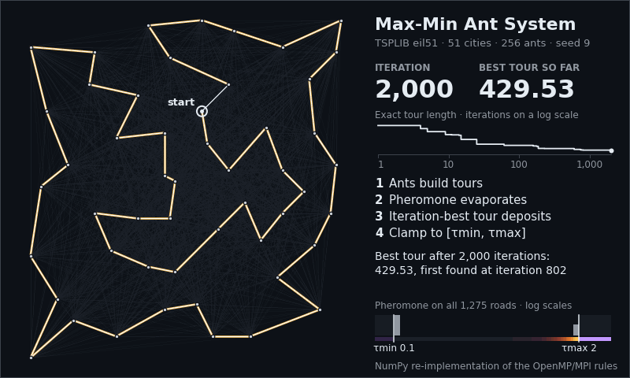
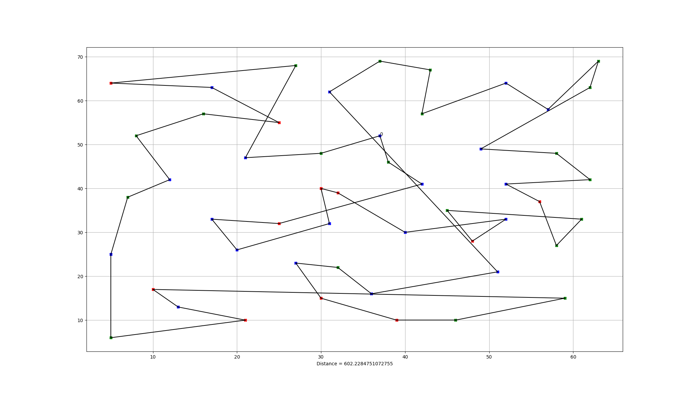
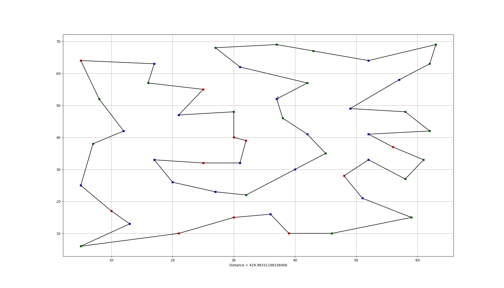
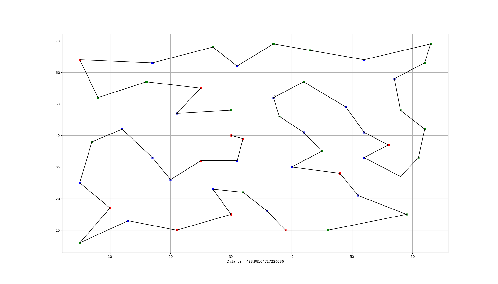
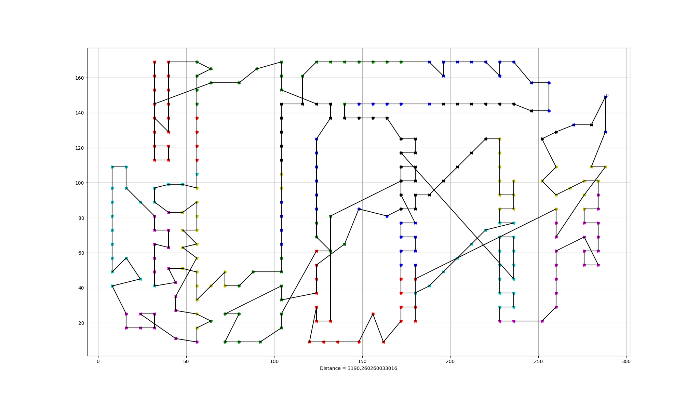
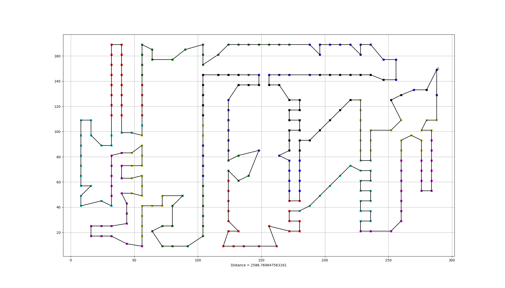

# Parallel Max-Min Ant System for the TSP

C++ implementations of the **Max-Min Ant System (MMAS)**, an Ant Colony Optimization (ACO) algorithm, for the Travelling Salesman Problem. There are three versions:

- **Serial**, the baseline
- **OpenMP**, where the ants of each iteration build their tours on parallel threads
- **Hybrid MPI + OpenMP**, which follows the communication-reduced scheme of Gu Weidong et al. [3]. Processes never build or send an n × n distance or pheromone matrix. Each iteration they exchange only the best tour, which is n integers.

This was a research project for CMSC 603 and CMSC 502 at Virginia Commonwealth University (Fall 2023), benchmarked on the university's Huff and Maple clusters with the TSPLIB instances eil51 and a280.

<p align="center">
  
</p>

<p align="center"><sub>Rendered by <a href="scripts/animate_aco.py"><code>scripts/animate_aco.py</code></a>, a NumPy re-implementation of the update rules used by the OpenMP and MPI builds, not output of the C++ programs. Details under <a href="#animation">Animation</a>.</sub></p>

## Contents

- [Background](#background)
- [Implementations](#implementations)
- [Repository layout](#repository-layout)
- [Building](#building)
- [Running](#running)
- [Plotting tours](#plotting-tours)
- [Results](#results)
- [Known limitations](#known-limitations)
- [Future work](#future-work)
- [References](#references)

## Background

### The Travelling Salesman Problem

Given a set of cities and the distance between each pair, the TSP asks for the shortest tour that visits every city exactly once and returns to the start. The problem is NP-hard. Brute force takes O(n!) time and the Held–Karp dynamic program takes O(n² · 2ⁿ), so large instances need heuristics. The TSP shows up in logistics, planning, circuit-board drilling (a280 is a drilling problem), DNA sequencing and astronomy.

### Ant Colony Optimization

Real ants find short paths between nest and food by laying pheromone trails that other ants tend to follow. ACO [1] copies this behaviour. In every iteration, *m* virtual ants each build a complete tour. An ant *k* at city *i* moves to an unvisited city *j* with probability

```math
p_{ij}^{k} =
\begin{cases}
\dfrac{\tau_{ij}^{\,\alpha}\;\eta_{ij}^{\,\beta}}{\sum_{s \in \text{allowed}_k} \tau_{is}^{\,\alpha}\;\eta_{is}^{\,\beta}} & \text{if } j \in \text{allowed}_k \\[2ex]
0 & \text{otherwise}
\end{cases}
\qquad\text{where } \eta_{ij} = \frac{1}{d_{ij}}
```

Here τ<sub>ij</sub> is the pheromone on edge (i, j), d<sub>ij</sub> is the distance, allowed<sub>k</sub> is the set of cities ant *k* hasn't visited yet, and α and β set how much pheromone counts against distance.

When every ant has finished, pheromone evaporates at rate ρ and the edges of a good tour are reinforced. Short edges therefore become more attractive in later iterations.

### Max-Min Ant System

MMAS [2] is one of the strongest ACO variants for the TSP. It changes plain ACO in three ways:

1. **Only the best ant of the iteration** deposits pheromone.
2. **Every pheromone value is clamped** to [τ<sub>min</sub>, τ<sub>max</sub>]. No edge can dominate, and none drops out of the search entirely.
3. **The pheromone matrix starts at τ<sub>max</sub>**, which encourages early exploration.

The update these programs apply after each iteration is

```math
\tau_{ij} \leftarrow \max\Big(\tau_{\min},\ \min\big(\tau_{\max},\ (1-\rho)\,\tau_{ij} + \Delta\tau_{ij}\big)\Big),
\qquad
\Delta\tau_{ij} =
\begin{cases}
Q / L_{\text{best}} & \text{if } (i,j) \text{ is on the iteration-best tour} \\
0 & \text{otherwise}
\end{cases}
```

where *L*<sub>best</sub> is the length of the iteration-best tour and *Q* is a constant that the reports describe as an estimate of the optimal tour length.

The animation at the top of this page plays one iteration of this update in slow motion.

### Why it parallelizes

Within one iteration the ants don't interact. Every ant reads the same pheromone matrix and builds its tour independently. Tour construction takes almost all of the run time, so it can be split across threads and processes. Only the pheromone update between iterations needs coordination.

## Implementations

| Program | Source | Parallelism |
|---|---|---|
| `ACO_TSP_Serial` | [`src/ACO_TSP_Serial.cpp`](src/ACO_TSP_Serial.cpp) | None. This is the baseline. |
| `ACO_TSP_Threaded` | [`src/ACO_TSP_Threaded.cpp`](src/ACO_TSP_Threaded.cpp) | OpenMP: `#pragma omp parallel for` over the ants of each iteration |
| `ACO_TSP_MPI` | [`src/ACO_TSP_MPI.cpp`](src/ACO_TSP_MPI.cpp) | MPI processes, each running its own ants on OpenMP threads. `n_ants` is the count **per process**. |

All three versions work the same way in these respects:

- Every ant starts at city 0.
- Distances are exact Euclidean (`sqrtf`), not TSPLIB's rounded integers. See [Solution quality](#solution-quality).
- The program reports the best tour seen across all iterations.

### Communication scheme in the MPI version

A traditional parallel MMAS has rank 0 compute an n × n distance matrix and broadcast it. After each iteration, rank 0 collects the best tours and broadcasts the whole updated n × n pheromone matrix. For large instances that traffic and memory dominate. Following [3], this version avoids both:

| | Traditional parallel MMAS | This implementation |
|---|---|---|
| Distances | Rank 0 builds the n × n distance matrix and broadcasts it | Every rank reads the coordinates and computes distances when it needs them. No distance matrix exists. |
| Exchange each iteration | Rank 0 collects best tours and broadcasts the n × n pheromone matrix | One `float` gathered from each rank, two scalars broadcast, then the winning tour (n `int`s) |
| Pheromone matrix | Rank 0 owns it | Each rank keeps its own copy and applies the same update from the same tour, so the copies stay identical |

Each MPI iteration runs these steps:

1. Every rank builds tours for its `n_ants` ants on OpenMP threads and finds its local best.
2. `MPI_Gather` sends each rank's best tour length to rank 0.
3. Rank 0 picks the shortest. `MPI_Bcast` sends out the winning rank and its length.
4. The winning rank broadcasts its tour with `MPI_Bcast`.
5. Every rank updates its pheromone matrix locally with that tour.

The data sent per iteration drops from O(n²) to O(n).

## Repository layout

```
.
├── Makefile                  # builds the three programs into the repo root
├── src/
│   ├── ACO_TSP_Serial.cpp    # serial MMAS
│   ├── ACO_TSP_Threaded.cpp  # OpenMP
│   └── ACO_TSP_MPI.cpp       # MPI + OpenMP, reduced communication
├── scripts/
│   ├── run.sh                # Slurm job: serial build on a280
│   ├── run_MPI_Huff.sh       # Slurm job: MPI build on a280 (Huff cluster)
│   ├── run_MPI_maple.sh      # MPI build on eil51 (Maple cluster)
│   ├── run_threaded.sh       # OpenMP build on eil51
│   ├── plot_graph.py         # plot a saved tour and print its length
│   ├── animate_aco.py        # render the README animation (NumPy re-implementation)
│   └── clean_optimal.py      # convert a TSPLIB optimal tour into the format used here
├── datasets/                 # TSPLIB instances (.tsp) and their known optimal lengths (solutions)
├── outputs/                  # saved coordinates and tours for eil51 and a280
├── output_images/            # plots of those tours, and the README animation
└── results/runtimes.txt      # raw MPI timings in ms (CMSC 502 runs)
```

`datasets/` holds TSPLIB instances from 51 to 18,512 cities. `datasets/solutions` lists TSPLIB's known optimal tour lengths [4]. Only eil51 and a280 were benchmarked.

## Building

Requirements:

- **GCC with OpenMP.** The sources include `<bits/stdc++.h>`, which is specific to GCC.
- **An MPI implementation that provides `mpicxx` and `mpirun`**, such as Open MPI.
- **Python 3 with matplotlib** (which brings NumPy and Pillow), only needed for plotting and for rebuilding the animation.

```bash
make                  # builds ACO_TSP_Serial, ACO_TSP_Threaded and ACO_TSP_MPI
make ACO_TSP_Serial   # or build just one
make clean
```

Tested with GCC 11.4 and Open MPI 4.1.2 on Ubuntu 22.04.

## Running

All three programs take the same nine arguments:

```bash
./ACO_TSP_Serial <tsp_file> <n_ants> <iterations> <alpha> <beta> <rho> <tau_max> <tau_min> <q>
```

| # | Argument | Meaning | Used in the reports |
|---|---|---|---|
| 1 | `tsp_file` | TSPLIB file with `EUC_2D` coordinates | `datasets/eil51.tsp`, `datasets/a280.tsp` |
| 2 | `n_ants` | Ants per iteration (per process for the MPI build) | see [Results](#parallel-performance) |
| 3 | `iterations` | Number of iterations | 2000 |
| 4 | `alpha` | Pheromone exponent α | 1 |
| 5 | `beta` | Distance exponent β | 3.5 (eil51), 5.5 (a280) |
| 6 | `rho` | Evaporation rate ρ | 0.1 |
| 7 | `tau_max` | Upper pheromone bound, also the starting value | 2 |
| 8 | `tau_min` | Lower pheromone bound | 0.1 |
| 9 | `q` | Deposit constant Q | see `scripts/` |

Examples:

```bash
# Serial, eil51
./ACO_TSP_Serial datasets/eil51.tsp 100 2000 1 3.5 0.1 2 0.1 430

# OpenMP, eil51, 8 threads
OMP_NUM_THREADS=8 ./ACO_TSP_Threaded datasets/eil51.tsp 256 2000 1 3.5 0.1 2 0.1 430

# MPI + OpenMP, a280, 4 processes with 25 ants each
mpirun -np 4 ./ACO_TSP_MPI datasets/a280.tsp 25 2000 1 5.5 0.1 2 0.1 2590
```

### Scripts

The scripts in `scripts/` hold the exact settings used for the experiments. They use paths relative to the current directory, so run them from the repository root, for example `sbatch scripts/run.sh` or `bash scripts/run_threaded.sh`.

| Script | What it runs |
|---|---|
| `run.sh` | Slurm job: serial build on a280, 100 ants, 2000 iterations |
| `run_MPI_Huff.sh` | Slurm job: MPI build on a280, 2 processes × 50 ants with 25 CPUs each. It pins node `huff27`; remove that line on other clusters. |
| `run_MPI_maple.sh` | MPI build on eil51, 4 processes × 50 ants. Writes `log_mpi.txt`. |
| `run_threaded.sh` | OpenMP build on eil51, 2000 ants. Writes `log_threaded.txt`. |

### Output

Each program prints:

- the elapsed time, which is wall-clock time even though the message says "CPU time for single-thread"
- the best tour length
- the tour as 0-indexed city ids, ending back at the start city

The serial and OpenMP builds also print the city coordinates. The OpenMP build additionally prints the iteration-best tour every 500 iterations.

## Plotting tours

`outputs/<dataset>/` holds these files:

| File | Contents |
|---|---|
| `coordinates.csv` | One `x,y` line per city, copied from the `Cities:` block of the output |
| `path.txt` | The best tour, copied from the `Order of cities` line |
| `path0.txt`, `path500.txt`, `path1000.txt`, `path1500.txt` | Iteration-best tours at those iterations, from the OpenMP build |
| `path_optimal.txt` | TSPLIB's optimal tour, converted to the same format |

To plot one, run from the repository root:

```bash
python3 scripts/plot_graph.py
```

The script asks for the dataset name (for example `eil51`) and which tour to show: `-1` for the final tour, `-2` for the optimal one, or an iteration number such as `500`. It prints the tour's exact length and opens the plot. The images in `output_images/` were saved from that window.

To add an optimal tour:

1. Paste the 1-indexed city ids from TSPLIB's `<name>.opt.tour` into `outputs/<name>/path_optimal.txt`, comma-separated or one per line, without the trailing `-1` / `EOF`.
2. Run `python3 scripts/clean_optimal.py` **once**. It rewrites the file in place with 0-indexed ids and closes the loop. A second run would shift the ids again.

### Animation

The animation at the top of this page is rendered by [`scripts/animate_aco.py`](scripts/animate_aco.py), not by the C++ programs. The script re-implements the update rules of the OpenMP and MPI builds in NumPy:

- every ant starts at city 0 and picks its next city with the probability rule above
- only the iteration-best ant deposits Q/L, in both directions
- the closing edge back to city 0 is never reinforced
- every value is clamped to [τ<sub>min</sub>, τ<sub>max</sub>]

It runs eil51 for 2000 iterations with 256 ants, α = 1, β = 3.5, ρ = 0.1, τ<sub>min</sub> = 0.1, τ<sub>max</sub> = 2 and Q = 430, the OpenMP eil51 example under [Running](#running). The eil51 scripts in `scripts/` pass Q = 2580 and 2587 instead.

To rebuild it (about 25 seconds):

```bash
python3 scripts/animate_aco.py
```

The script prints the run's key numbers and the GIF's size and SHA-1. If a caption in the animation would be false for the run (for example, if the final pheromone trail isn't exactly the best tour), it stops with an error and leaves the committed GIF untouched.

- **Seed 9 was chosen** because its pheromone settles onto a single trail, and that trail follows exactly its best tour. Both are rare with these settings: in most runs, the C++ ones included, the iteration-best tour is still changing at iteration 2000. `python3 scripts/animate_aco.py --seed 0 --find-seed` reports seeds 0 to 8 failing this check before it renders seed 9.
- **The trail stays open at the start city** because the closing edge is never reinforced. The white tour line closes it.
- **The counter numbers iterations from 1 to 2000.** The snapshot table under [Solution quality](#solution-quality) uses the C++ programs' 0-based iteration numbers.
- **Lengths are exact Euclidean distances**, the same metric as the 429.98 quoted for TSPLIB's optimal tour. The animation's final tour can therefore come out slightly shorter than that without beating TSPLIB's optimum of 426 (see [Solution quality](#solution-quality)). The script also prints the tour's TSPLIB-rounded length.

## Results

### Solution quality

| | eil51 | a280 |
|---|---|---|
| TSPLIB optimum (edges rounded to integers) | 426 | 2579 |
| The same optimal tour, exact distances | 429.98 | 2586.77 |
| Best tour found, exact distances | **428.98** | **2930.17** (CMSC 502), 2960.55 (CMSC 603) |
| Gap to the optimum | +0.23% under TSPLIB rounding (427 vs. 426) | +13.3% (exact distances) |

**Why the eil51 tour looks shorter than the optimum.** TSPLIB's `EUC_2D` metric rounds every edge to the nearest integer, and the published optima are optimal *for that rounded metric*. These programs measure exact distances instead. In the saved eil51 runs, the colony reached TSPLIB's optimal tour by iteration 1000 (exact length 429.98). The best tour found, 428.98, is a different tour: shorter under exact distances, but longer under TSPLIB's rounding (427 vs. 426). So the result doesn't beat the known optimum. The two numbers measure slightly different objectives.

The saved tours in `outputs/` show how the search converges. Lengths are exact distances, as printed by `plot_graph.py`. `path.txt` didn't necessarily come from the same run as the iteration snapshots (for eil51 it didn't), so read the table as a picture of convergence rather than a single trace.

| Saved tour | eil51 | a280 |
|---|---|---|
| Iteration 0 (first) | 602.23 | 4736.15 |
| Iteration 500 | 431.56 | 3580.66 |
| Iteration 1000 | 429.98 † | 3571.54 |
| Iteration 1500 | 429.98 † | 3573.84 |
| Best overall (`path.txt`) | 428.98 | 3190.26 |
| TSPLIB optimal tour | 429.98 | 2586.77 |

† The same tour as TSPLIB's optimal tour.

The saved a280 tour (3190.26) is from an earlier run, not the best one reported (2930.17).

**eil51**

| After the first iteration (602.23) | Iteration 1000, the TSPLIB optimal tour (429.98) | Best found (428.98) |
|---|---|---|
|  |  |  |

**a280**

| Saved best tour (3190.26) | TSPLIB optimal tour (2586.77) |
|---|---|
|  |  |

### Parallel performance

Both course reports timed the MPI + OpenMP build on Huff with 1, 2, 4 and 8 processes, and report the median of 3 runs. Every run used α = 1, ρ = 0.1, τ<sub>max</sub> = 2, τ<sub>min</sub> = 0.1 and 2000 iterations, with β = 3.5 for eil51 and 5.5 for a280.

**CMSC 603 runs.** These used 256 ants in total, divided evenly across the processes, and each process was given m / p CPUs.

| Processes | eil51 time (s) | eil51 speedup | a280 time (s) | a280 speedup |
|---:|---:|---:|---:|---:|
| 1 | 123.02 | 1.00 | 168.70 | 1.00 |
| 2 | 55.14 | 2.23 | 92.29 | 1.82 |
| 4 | 59.40 | 2.07 | 63.65 | 2.65 |
| 8 | 37.56 | 3.27 | 56.84 | 2.96 |

**CMSC 502 runs.** These used about 100 ants split across the processes. The per-process counts in the table come from `results/runtimes.txt`; the report's parameter table lists m = 256 for a280.

| Processes | Ants per process | eil51 time (s) | eil51 speedup | a280 time (s) | a280 speedup |
|---:|---:|---:|---:|---:|---:|
| 1 | 100 | 178.47 | 1.00 | 5240.94 | 1.00 |
| 2 | 50 | 48.54 | 3.67 | 1976.55 | 2.65 |
| 4 | 25 | 30.05 | 5.94 | 152.54 | 34.36 |
| 8 | 13 | 28.30 | 6.30 | 139.54 | 37.56 |

Most of the CMSC 502 speedups exceed the number of processes, for example 34× on 4 processes for a280. The cause wasn't investigated, so treat those numbers with caution.

`results/runtimes.txt` holds the raw timings. Two of its entries differ from the report's table: eil51 at 2 processes (48.84 s) and a280 at 4 processes (132.78 s).

In both sets, splitting the colony across processes cut the run time substantially. Neither report compared against the traditional matrix-broadcast scheme, so these numbers don't isolate how much the reduced communication contributes.

## Known limitations

- **Random numbers.** All randomness comes from `rand()` seeded with `srand(time(0))`. MPI ranks that start in the same second therefore share a seed, and all OpenMP threads in a process share one generator.
- **Tour construction is O(n³) per ant.** Visited cities are found by scanning the ant's partial tour. Together with two n × n pheromone matrices per process, this makes the large instances in `datasets/` (d15112, d18512, usa13509) impractical without changes.
- **Pheromone deposit differs between builds.** The serial build reinforces only the direction an edge was travelled. The OpenMP and MPI builds reinforce both directions. None of them reinforces the closing edge back to the start city.

## Future work

Because a single iteration's ants are independent, the number that can run at once is limited by CPU cores. A GPU implementation could run thousands of ants per iteration, which would give much broader exploration of the search space at a similar cost per iteration.

## References

1. A. Colorni, M. Dorigo and V. Maniezzo, "Distributed Optimization by Ant Colonies," *Proceedings of the First European Conference on Artificial Life*, pp. 134–142, 1991.
2. T. Stützle and H. H. Hoos, "MAX–MIN Ant System," *Future Generation Computer Systems*, vol. 16, no. 8, pp. 889–914, 2000. [doi:10.1016/S0167-739X(00)00043-1](https://doi.org/10.1016/S0167-739X(00)00043-1)
3. G. Weidong, F. Jinqiao, W. Yazhou, Z. Hongjun and H. Jidong, "Parallel Performance of an Ant Colony Optimization Algorithm for TSP," *2015 8th International Conference on Intelligent Computation Technology and Automation (ICICTA)*, pp. 625–629, 2015. [doi:10.1109/ICICTA.2015.159](https://doi.org/10.1109/ICICTA.2015.159)
4. G. Reinelt, "TSPLIB — A Traveling Salesman Problem Library," *ORSA Journal on Computing*, vol. 3, no. 4, pp. 376–384, 1991.
